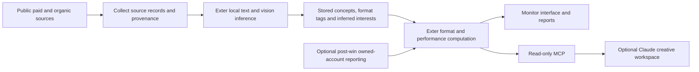

# Exter owns the intelligence pipeline

The primary workflow is **public competitor/category research before winning a client**. A client advertising account is not a prerequisite. Connecting owned accounts is an optional post-win layer for comparing private performance with the public landscape.



Claude does not run Exter's ingestion, model inference or metric calculations. The platform can operate independently of a Claude account. Claude's MCP tools read the platform's stored results and source evidence for downstream briefs, scripts and strategies.

## Internal inference implemented

The server runs pinned, open-source models on its own CPU:

- Text: `Xenova/all-MiniLM-L6-v2`, revision `751bff37182d3f1213fa05d7196b954e230abad9`.
- Still-image concepts: `Xenova/clip-vit-base-patch32`, revision `6b7c523703ae26e39be4b03774966f8571c7f523`.

Exter owns the pipeline, schemas, stored intelligence and computations. These are pretrained open-source models, not a newly trained proprietary foundation model. The initial engine uses semantic similarity, still-image zero-shot concept interpretation and source-text extraction. It does not yet provide full video-frame/audio analysis, OCR, open-ended research-grade semantic reasoning, calibrated demographic estimates or attention heatmaps. Missing fields remain unknown. Similarity scores are not probabilities or proof of an audience trait.

`POST /api/brain/analyse` queues up to 25 existing records for analysis. `GET /api/brain/jobs/:id` exposes progress. Results persist in SQLite; job progress is currently in process memory and does not survive a restart. Public URL collection automatically queues a batch when source text is available. Models load lazily, cache in `.data/models`, and require neither Claude nor an external model API key. Source dates, metrics and inferred concepts are separate fields.

```sh
npm run models:verify
NODE_USE_ENV_PROXY=1 node --import tsx scripts/verify-public-brain.ts
```

The model check ran actual text and visual inference. The end-to-end public check collected a submitted public X post, ran local semantic inference and stored its annotation without client-account or Claude access. This validates a single source URL, not complete category coverage or real-time performance intelligence.

## Public collection and actual limits

- Public URL collectors exist for TikTok, YouTube and X using their public embed endpoints. No client ad-account token is requested. Embed access varies; a source can withhold captions, active dates, media or counts. Such gaps are errors/unknowns, not invented data.
- The canonical X endpoint supplied source text during verification. The tested TikTok endpoint supplied only an iframe, without usable caption text; that collection was rejected. YouTube access was denied from this environment. The application does not bypass these restrictions.
- Instagram, Facebook, LinkedIn and comprehensive paid-ad transparency collection still require an approved public API or licensed public-data connector for Exter. This service access is different from a client's private advertising-account permission.
- Submitted URLs and public-content imports are supported; automatic brand/competitor discovery, exhaustive category collection and continuous multi-platform public monitoring are **not connected**. No claim to read every post is made.
- oEmbed is not an engagement-reporting API. It generally does not supply impressions, conversions or a reliable active date. An observation timestamp must not become a fictitious publication/active date. Public metadata with missing metrics cannot win a performance ranking.

Imports accept paid/organic source classification, explicit creative-format labels, structured analysis and declared public engagement bases such as views or followers. Mixed denominator bases, currencies or conversion-event definitions cannot produce a valid combined ranking. Competitor conversion data is never inferred from public engagement.

## Optional client data and Claude

Owned Meta, TikTok and Google reporting adapters and polling are a separate phase-two module. They need approved account reporting credentials and were validated with mocked provider responses, not live client credentials. They preserve public/import data, bind accounts to workspaces and retain successful reporting history after failures.

The read-only MCP server is implemented and tested with an actual SDK stdio handshake. Claude Desktop setup is documented in [CLAUDE.md](CLAUDE.md). No user's Claude client was connected. Claude web/team access still needs a hosted authenticated MCP endpoint and tenant controls; the local server is not a team deployment.

The downloadable HTML is a sample-data test drive of the interface and deterministic analytics. Public collection and local model execution run in the full server application, not inside the standalone HTML file.
