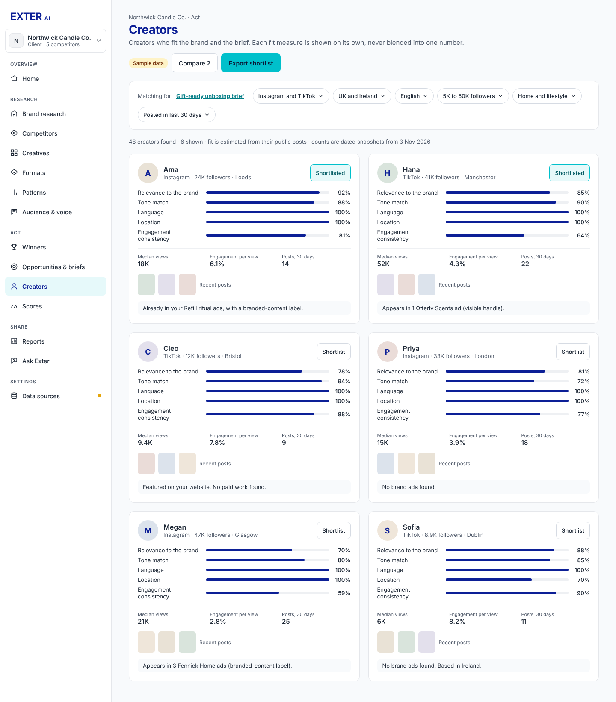
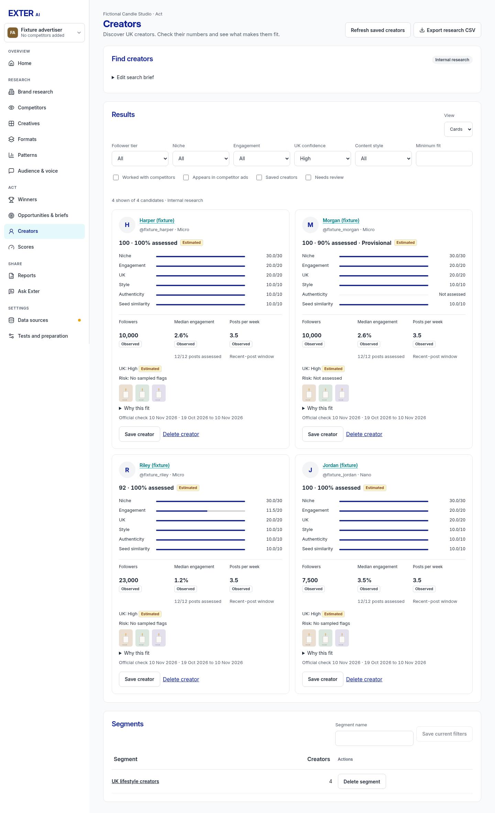

# Creator discovery visual review

10 November 2026. These screenshots use the actual React creator page, shared
Sidebar, tokens, CSS and Accuracy page in a temporary read-only fixture harness.
All profiles, counts and thumbnails are fictional test inputs. They are **not
live research, provider access checks or precision validation**. External network
traffic was blocked. The harness and its fixtures do not ship in the app bundle.

Cards were checked at 1280, 1440, 1920 and 390px; no document overflow occurred.
The 1440px table, expanded find form and Accuracy changes were also inspected.

| Approved creator reference | New creator workflow, 1440px |
| --- | --- |
|  |  |

Additional views: [table](creators-table-1440.png),
[find form](creators-form-1440.png), [mobile](creators-390.png),
[1280px](creators-1280.png), [1920px](creators-1920.png),
[Accuracy](accuracy-1440.png).

Kept differences required by the new brief:
- Find creators, Results and Segments replace the earlier single shortlist.
- The search form is collapsible once results exist, keeping results accessible.
- Six labelled filters and four toggles replace the older broad platform filters.
- Six fit components, coverage and Provisional replace the old five fit measures.
- The requested official median-per-follower rate replaces the older per-view rate.
- All five-check/Working Score formulas elsewhere remain unchanged.
- Save/delete actions stay at the card bottom; unknown checks have no zero bar.
- Only UK Instagram discovery is added; existing sample rendering is preserved.
- Accuracy has no reference PNG; it reuses the existing measurement table.

Find creators configuration is Real data; the cost ceiling and fit are Compute
now/Estimated. Official counts are Real data only after the official check.
Niche, style, UK and risk are Compute now/Estimated. Segments are saved filters
with computed counts. Client validation is Unavailable until real labels pass
both gates. Missing official metrics stay Unverified; no values are guessed.
