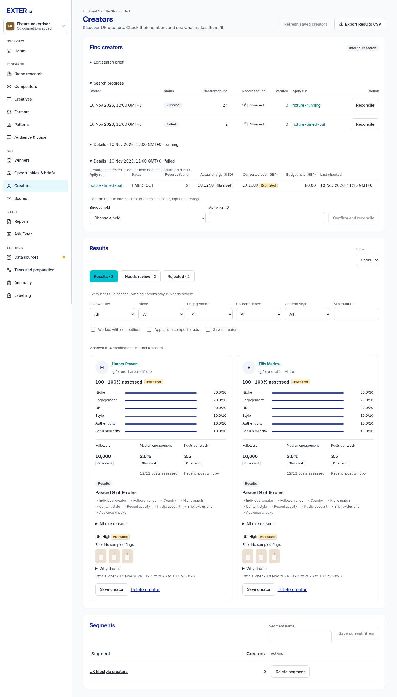
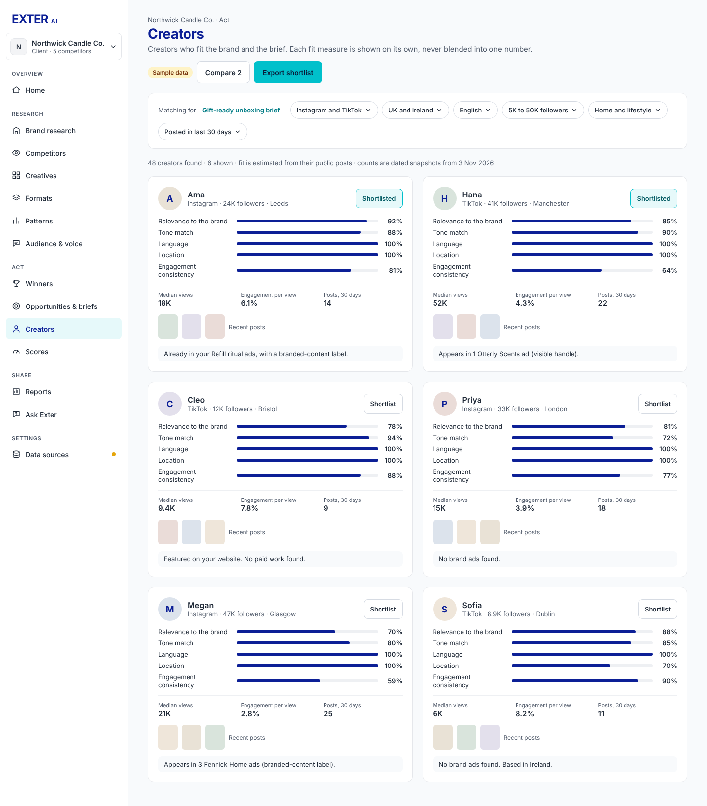
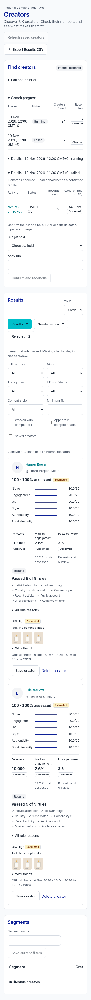

# Creator run recovery review

Captured 10 November 2026 from actual React components with isolated fictional
API fixtures. No live provider requests or real billing reconciliation. Browser
checks pass at 1280, 1440, 1920 and 390px, with no page overflow or console errors.

| Current app, 1440px | Approved Creators reference |
| --- | --- |
|  |  |

Search history remains inside Find creators. The requested run IDs, live record
counts, charges, Reconcile actions and legacy confirmation form are additions to
the approved reference. Shared tables, labels, subgrid cards and spacing remain.
Mobile tables scroll within their card. Record counts may include posts and
repeated creators; they never claim to be qualified individual creators.

The browser exercised both Reconcile and Confirm and reconcile, checked their
workspace/search/hold payloads and verified queued actions become disabled. All
provider access was replaced by local fixture replies. The actual database/API
integration separately verifies actor/input/hold matching and idempotent settlement.
