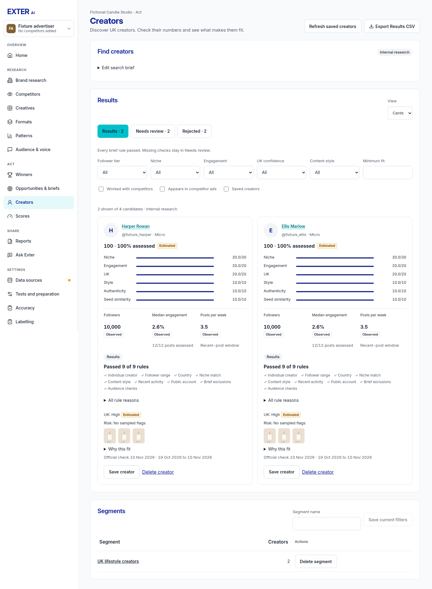
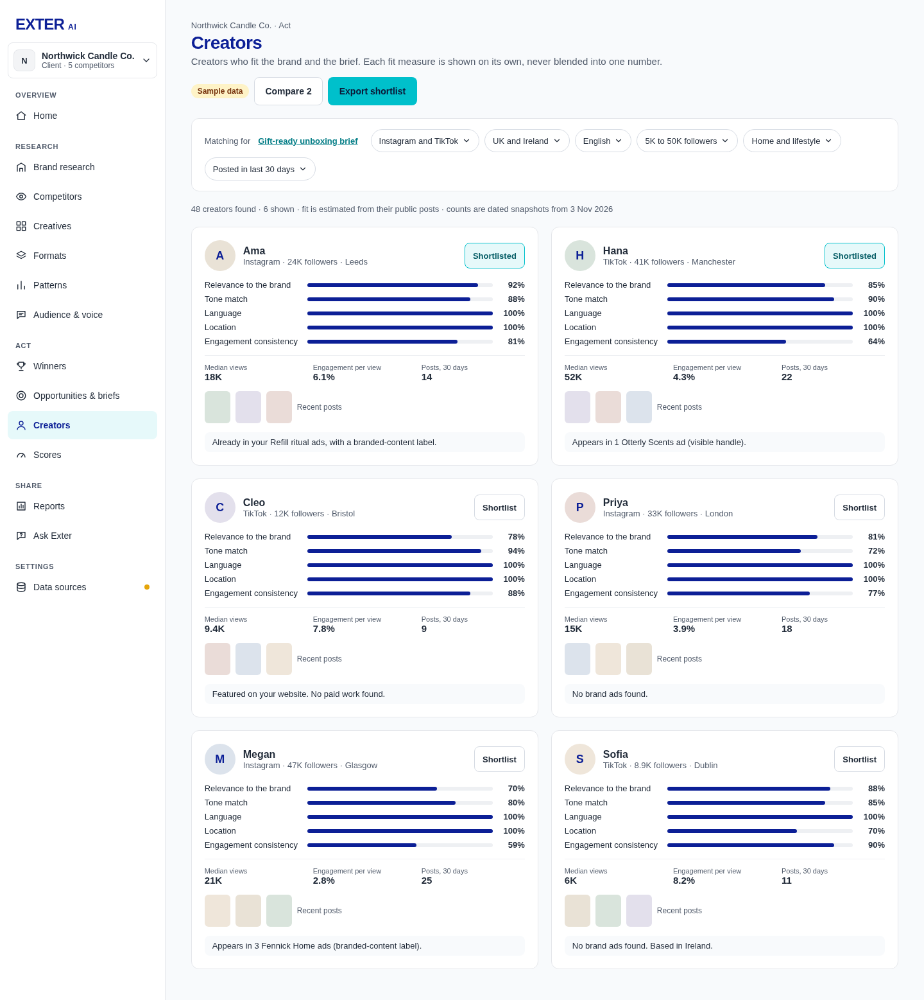
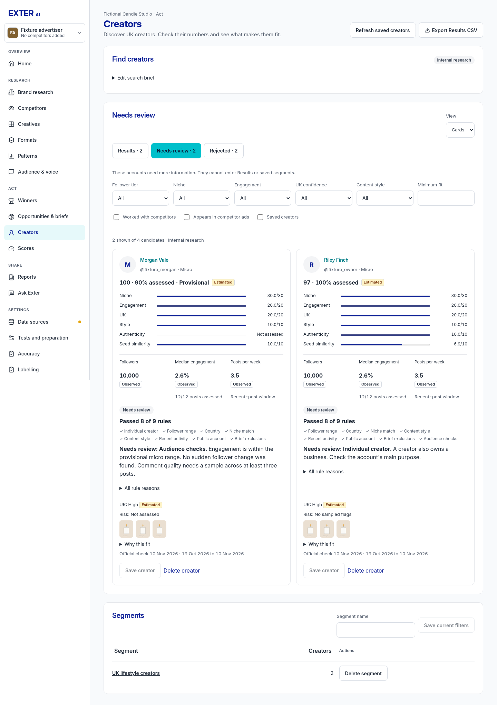
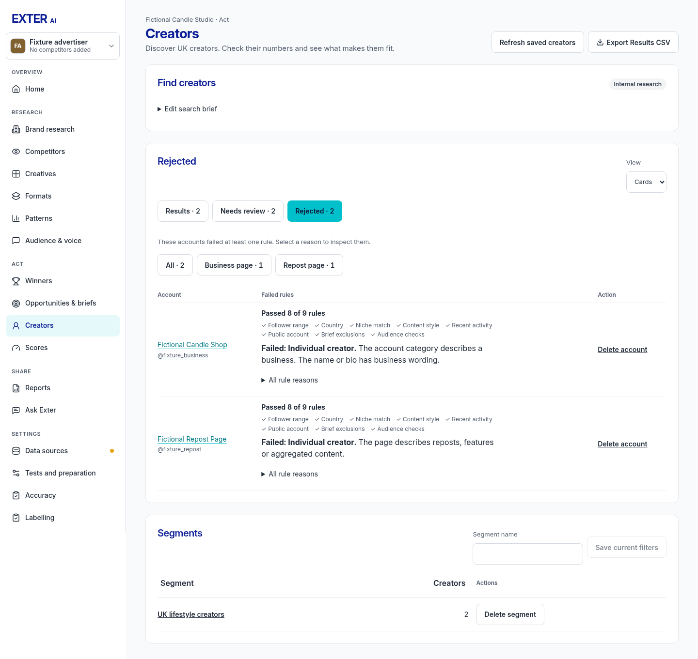
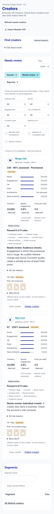
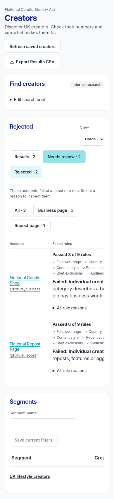
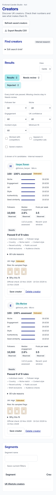
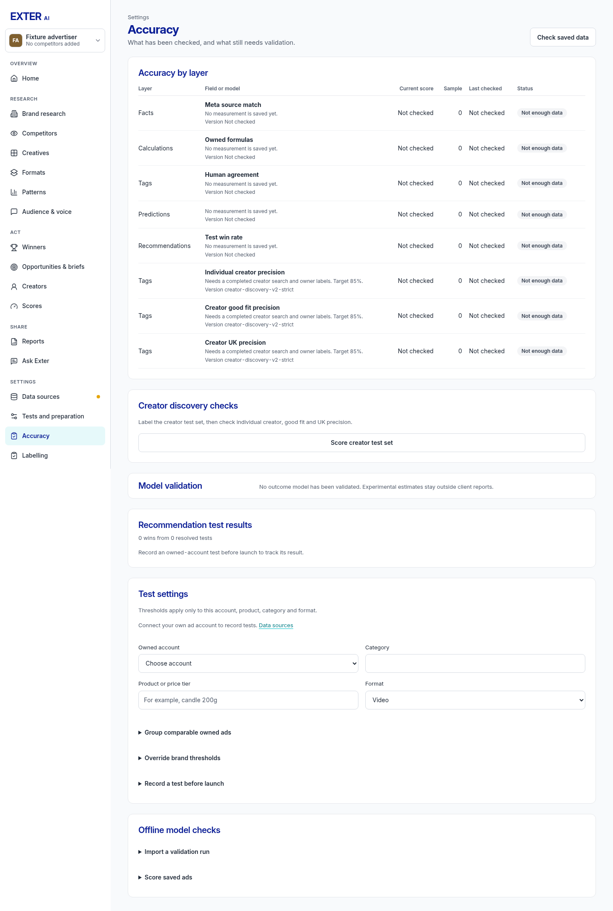

# Strict creator screening review

Captured 10 November 2026 from the actual React pages with isolated fictional
API fixtures. No live creator, actor or official provider calls were made. These
screenshots are not validation evidence. Tested widths: 1280, 1440, 1920 and 390px.

| Current app, 1440px | Approved creator reference |
| --- | --- |
|  |  |

| Needs review | Rejected |
| --- | --- |
|  |  |
|  |  |

Differences retained from the older creator reference are required by the owner:
Find creators and saved segments from PR #29; exclusive screening lists, rejection
reason filters, visible passed rules, official-count metrics and three accuracy
checks. No guessed metrics, fixed sample creator counts or client-ready claims.
Cards reuse the existing subgrid, fit bars, source labels and aligned action rows.
Mobile tables keep their existing horizontal scroll area. Caveats stay behind
About this data; specific failed or unknown rules remain visible for diagnosis.
